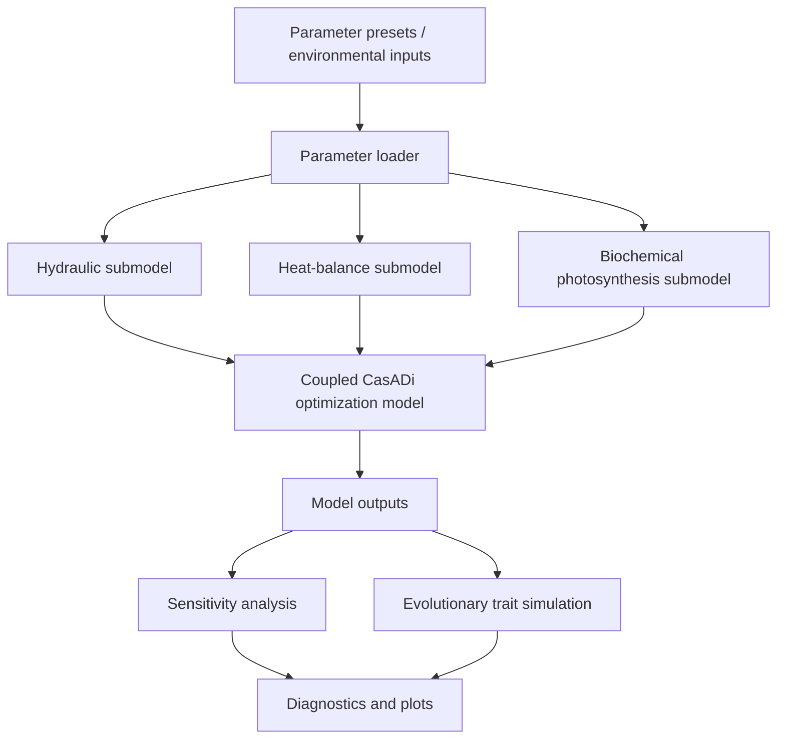

# Photosynthesis climate-adaptation model

Postdoctoral research code for modelling photosynthesis, leaf heat balance, hydraulics, and evolutionary trait adaptation across environmental conditions.

The repository organizes a coupled C3/C4 photosynthesis modelling workflow into a reproducible Python package. The model links biochemical carbon assimilation, stomatal/hydraulic constraints, heat balance, sensitivity analysis, and evolutionary optimization of selected traits.

## Scientific scope

The project explores how environmental conditions and plant traits interact to shape photosynthetic performance. It combines:

- biochemical C3/C4 photosynthesis modelling,
- mesophyll and bundle-sheath compartment structure,
- PEPC and Rubisco capacity allocation,
- stomatal conductance and hydraulic limitation,
- leaf energy balance and compartment temperatures,
- parameter sensitivity analysis,
- evolutionary trait exploration across climate presets.

## Software architecture



## Repository structure

```text
photosynthesis-climate-adaptation-model/
├── src/photosynthesis_adaptation/   # reusable Python package
│   ├── model/                       # biochemical, heat, hydraulic, and coupled model modules
│   ├── utils/                       # evolution, sensitivity, plotting, API, unit conversion
│   ├── resources/                   # bundled parameter presets
│   └── parameters.py                # package-safe parameter loader
├── scripts/                         # reproducible command-line workflows
├── tests/                           # lightweight tests
├── docs/                            # architecture, audit, provenance
├── legacy/                          # selected original material and file manifests
├── Dockerfile                       # reproducible Python runtime
├── environment.yml                  # conda/mamba environment
├── pyproject.toml
└── README.md
```

## Main components

| Component | Module | Role |
|---|---|---|
| Parameter layer | `photosynthesis_adaptation.parameters` | Loads bundled biochemical, environmental, hydraulic, heat, soil, and temperature-dependence presets. |
| Hydraulic model | `model/hydraulic_model.py` | Computes water-supply and transpiration constraints. |
| Heat model | `model/heat_model.py` | Computes mesophyll and bundle-sheath heat-balance terms. |
| Biochemical model | `model/biochemical_model.py` | Computes PEPC/Rubisco kinetics and CO₂ assimilation. |
| Coupled solver | `model/model_builder.py` | Builds and solves the CasADi optimization problem. |
| Sensitivity analysis | `utils/sensitivity_analysis.py` | Supports local and Sobol-style sensitivity workflows. |
| Evolutionary simulation | `utils/evolution.py` | Runs a hybrid CMA/Kimura-style trait optimization workflow. |
| Plotting | `utils/evolution_plotting.py` | Provides diagnostic and trajectory plotting utilities. |

## Reproducibility

The recommended route is Docker:

```bash
docker build -t photosynthesis-climate-adaptation-model:py311 .
docker run --rm photosynthesis-climate-adaptation-model:py311
```

Local installation:

```bash
python3 -m venv .venv
source .venv/bin/activate
python -m pip install --upgrade pip setuptools wheel
python -m pip install -e ".[dev]"
pytest -q
```

Conda/mamba alternative:

```bash
mamba env create -f environment.yml
mamba activate photosynthesis-adaptation
pytest -q
```

## How to use

List available parameter presets:

```bash
python scripts/00_list_parameter_presets.py
```

Run a minimal coupled-model smoke test:

```bash
python scripts/01_run_model_smoke.py
```

Run a short evolutionary workflow:

```bash
python scripts/02_run_short_evolution.py
```

Summarize preserved legacy manifests:

```bash
python scripts/03_manifest_summary.py
```

## Minimal Python example

```python
from photosynthesis_adaptation.parameters import load_parameters
from photosynthesis_adaptation.model import ModelBuilder

params = load_parameters(environment="default")

model = ModelBuilder(params)
model.build()
result = model.run()

print(result["assimilation_total"])
```

## Legacy material

The original postdoctoral working directories contained exploratory notebooks, generated plots, logs, solver outputs, and lab-rotation material. The main reusable code is now in `src/photosynthesis_adaptation/`.

Selected original files and complete file manifests are preserved under `legacy/` for provenance. The `lab_rotation-florian-haesen` material should be treated as supervised/teaching provenance material and not presented as sole-authored research output unless attribution and permissions are clarified.

## Research value

This repository demonstrates a postdoctoral modelling workflow that connects mechanistic plant physiology, numerical optimization, sensitivity analysis, and evolutionary simulation. It is intended to show the scientific and computational architecture of the project rather than simply archive a working directory.

## License and provenance

An MIT license is included as a practical default for the reusable code. Check attribution and permissions before redistributing any legacy or lab-rotation material.
