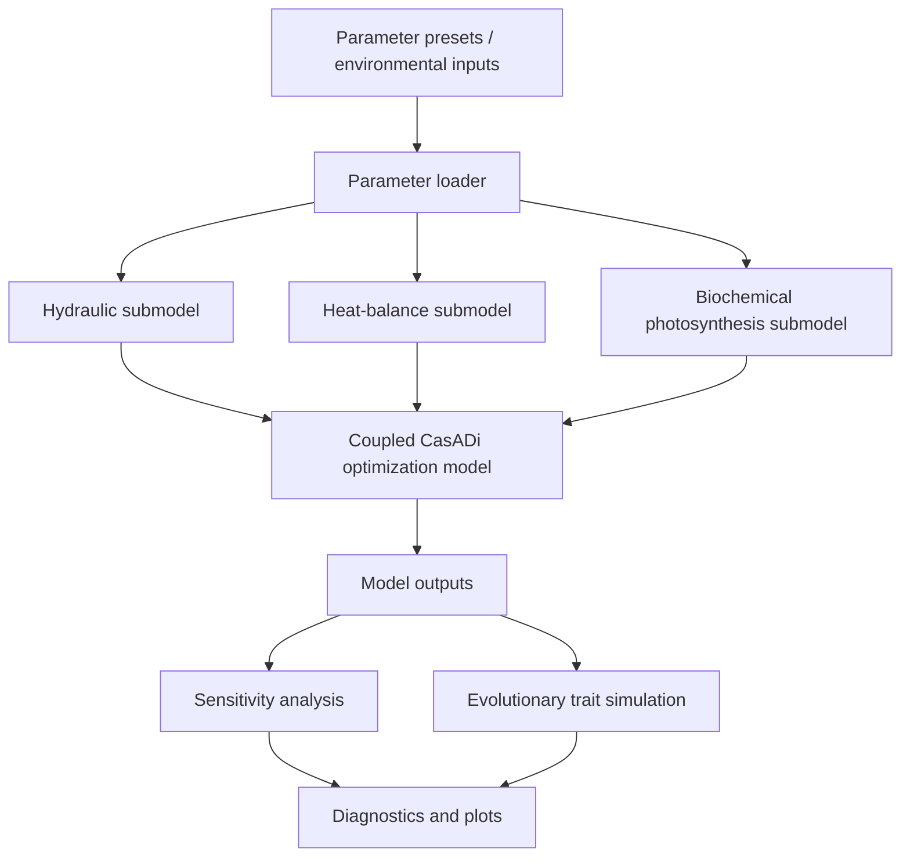

# Architecture

The repository is organized as a reproducible modelling pipeline.

## Components

| Layer | Module | Role |
|---|---|---|
| Parameters | `photosynthesis_adaptation.parameters` | Loads bundled JSON presets from package resources. |
| Hydraulics | `model/hydraulic_model.py` | Computes transpiration and water-supply constraints. |
| Heat balance | `model/heat_model.py` | Computes mesophyll and bundle-sheath temperature constraints. |
| Biochemistry | `model/biochemical_model.py` | Computes PEPC/Rubisco assimilation and temperature-dependent kinetics. |
| Coupling | `model/model_builder.py` | Builds and solves the coupled CasADi optimization problem. |
| Sensitivity | `utils/sensitivity_analysis.py` | Local and global sensitivity workflows. |
| Evolution | `utils/evolution.py` | Seeded CMA-ES optimization; not a population-genetic evolutionary model. |
| Scripts | `scripts/` | Minimal reproducible entry points. |
| Legacy | `legacy/` | Preserved manifests and selected original material. |
